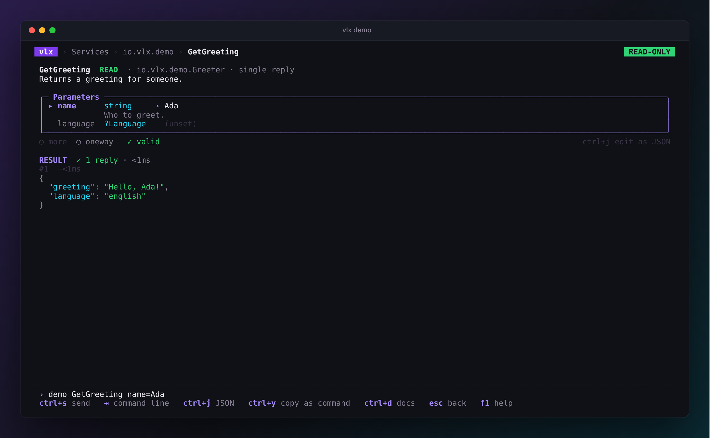
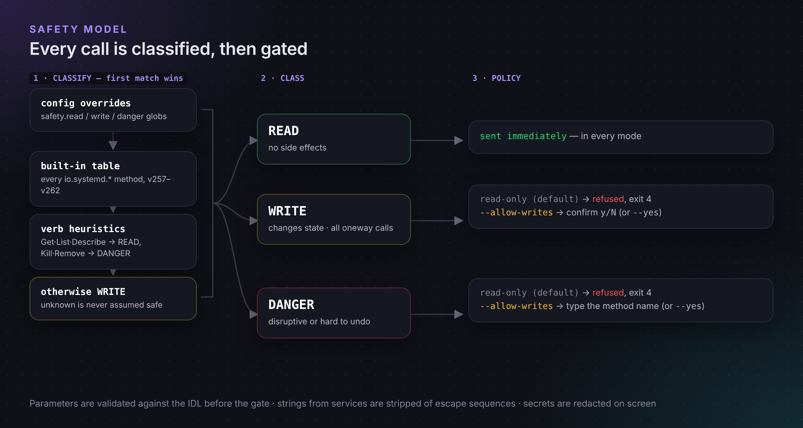

<p align="center">
  <a href="https://rossedman.github.io/vlx/">
    
  </a>
</p>

<p align="center">
  <a href="https://github.com/rossedman/vlx/actions/workflows/ci.yml"></a>
  <a href="https://github.com/rossedman/vlx/releases/latest"></a>
  <a href="https://goreportcard.com/report/github.com/rossedman/vlx"></a>
  <a href="LICENSE"></a>
  <a href="https://rossedman.github.io/vlx/"></a>
</p>

**vlx** is a terminal explorer for [Varlink](https://varlink.org/) services —
above all systemd's `io.systemd.*` APIs. It finds every Varlink socket on your
machine, lets you browse interfaces, methods, types and errors with the docs
that ship in their IDL, and calls methods with an editor that already knows
the schema. It is **read-only by default**.

<p align="center">
  
</p>

## QuickStart

```sh
go install github.com/rossedman/vlx/cmd/vlx@latest   # or grab a release below
vlx demo                                              # a sample service, works anywhere
```

Then:

1. ↑/↓ and **⏎** to drill down to a method — or just type: `demo GetGreeting name=Ada` **⏎**.
2. Fill in the form, or edit the command line under it; the two stay in sync.
3. **ctrl+s** to send. Replies stream in underneath.

On a Linux machine with systemd v257+, run plain **`vlx`** to explore your
system (`sudo vlx` for services that only talk to root).
[The full QuickStart →](https://rossedman.github.io/vlx/getting-started/quickstart/)

## Why

systemd is moving its APIs from D-Bus to Varlink. D-Bus has `busctl` and
`d-feet`; Varlink has `varlinkctl`, which is great if you already know the
method name and the JSON it wants. vlx is for everything before that:

| | |
| --- | --- |
| **Zero-config discovery** | Finds sockets in `/run/varlink/registry`, `/run/systemd/**`, `/run/udev` and your user session. |
| **Browse with docs** | Services grouped and described in plain language; one page per service and method, with doc comments and types. |
| **A command line** | Type to jump to any service, method, type or error, or run a call: `resolve ResolveHostname name=example.com`. |
| **Form-based calls** | One field per parameter, pickers for enums, inline docs and errors, kept in sync with the command line; Ctrl+J for raw JSON. |
| **Live streams** | `more` replies arrive as they happen; Esc stops them. |
| **Safe by default** | READ / WRITE / DANGER classification; writes need `--allow-writes` *and* a confirmation. |
| **Scriptable** | `vlx call … -o json`, NDJSON streams, stable exit codes. |
| **Teaches the CLI** | Every call can be copied as an equivalent `vlx call` or `varlinkctl call`. |

## Commands

```sh
vlx                                   # explore (TUI)
vlx list --probe                      # sockets on this host, and what they are
vlx info hostname                     # vendor, version, interfaces
vlx describe resolve                  # print the IDL
vlx template resolve ResolveHostname  # a JSON parameter skeleton
vlx call resolve ResolveHostname '{"name":"example.com"}'
vlx demo                              # try it without systemd
```

## Safety

<p align="center">
  
</p>

vlx talks to privileged services, often as root, so it is careful:

- **Read-only by default.** Only methods classified READ are sent. Every
  `io.systemd.*` method has an explicit class; unknown methods are WRITE.
- **Writes need intent.** `--allow-writes` enables them, each WRITE asks
  first and each DANGER method must be typed back by name.
- **Your terminal is protected.** Escape sequences from services are
  stripped; secrets such as password hashes and tokens are redacted on screen.
- **Small surface.** Unix sockets only, no shelling out, bounded timeouts and
  message sizes, received file descriptors closed at once, and config files
  others can write are refused.

Read [the safety guide](https://rossedman.github.io/vlx/guides/safety/).

## Install

| Method | Command |
| --- | --- |
| Go 1.26+ | `go install github.com/rossedman/vlx/cmd/vlx@latest` |
| Archives | [Releases](https://github.com/rossedman/vlx/releases) for Linux (amd64, arm64, armv7, riscv64, ppc64le, s390x) and macOS (amd64, arm64) |
| Packages | `.deb`, `.rpm` and `.apk` on every release, with completions and man pages |

## Documentation

**[rossedman.github.io/vlx](https://rossedman.github.io/vlx/)** — QuickStart,
guides to the explorer, calling, scripting, safety and configuration,
systemd recipes, and the full command reference. The design is written up in
the [specification](https://rossedman.github.io/vlx/project/spec/).

## Built with

[sdvarlink](https://github.com/rossedman/sdvarlink) ·
[Bubble Tea](https://github.com/charmbracelet/bubbletea) ·
[Bubbles](https://github.com/charmbracelet/bubbles) ·
[Lip Gloss](https://github.com/charmbracelet/lipgloss) ·
[Cobra](https://github.com/spf13/cobra) ·
[Viper](https://github.com/spf13/viper)

## Contributing

Issues and pull requests are welcome — see [CONTRIBUTING.md](CONTRIBUTING.md).

## License

[MIT](LICENSE)
