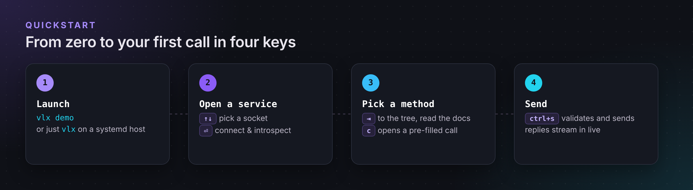
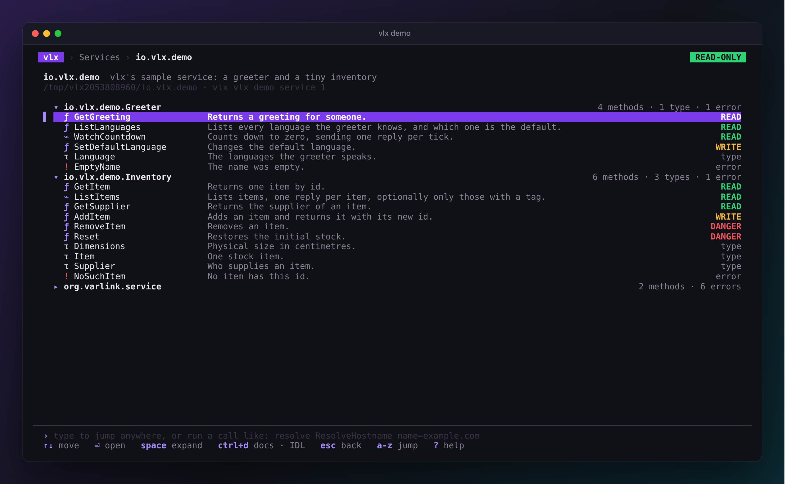

# QuickStart

{ .vlx-diagram }

## <span class="vlx-step">1</span> Install

=== "Go"

    ```sh
    go install github.com/rossedman/vlx/cmd/vlx@latest
    ```

=== "Download"

    Grab the archive for your platform from the
    [latest release](https://github.com/rossedman/vlx/releases/latest), then:

    ```sh
    tar -xzf vlx_*_linux_amd64.tar.gz vlx
    sudo install vlx /usr/local/bin/
    ```

=== "Debian / Ubuntu"

    ```sh
    sudo apt install ./vlx_*_linux_amd64.deb
    ```

=== "Fedora / RHEL"

    ```sh
    sudo dnf install ./vlx_*_linux_amd64.rpm
    ```

Check it works:

```sh
vlx version
```

More options, including shell completion, are on the
[Installation](installation.md) page.

## <span class="vlx-step">2</span> Open the demo

The demo service runs anywhere, so start there:

```sh
vlx demo
```

vlx starts a small sample service and opens the explorer on it. The
explorer shows one page at a time, with a command line along the bottom.

{ .vlx-shot }

Move with ++up++ / ++down++, open things with ++enter++, and go back up with
++esc++. Each method shows its safety class and the first line of its
documentation.

!!! tip "Lost? Press ++"?"++"
    The bottom line always shows the keys that work right now, and ++"?"++
    shows them all.

## <span class="vlx-step">3</span> Call a method

1. Select **GetGreeting** and press ++enter++.
2. Type a name, press ++down++, and pick a **language** with ++left++ /
   ++right++. The command line at the bottom spells out the same call.
3. Press ++ctrl+s++ to send.

{ .vlx-shot }

Or skip the clicking: type the whole call and press ++enter++.

```text
demo GetGreeting name=Ada language=german
```

Try a few more:

| Type this | What it shows |
| --- | --- |
| `demo WatchCountdown from=5` | a **stream**: one reply per tick, live. ++esc++ stops it. |
| `demo GetItem id=42` | a **typed error**, with its documentation from the IDL |
| `demo GetSupplier id=1` | a secret field shown as `«redacted»` (++shift+r++ reveals it) |
| `demo SetDefaultLanguage language=german` | a **WRITE** method, which vlx refuses to send in read-only mode |

Press ++esc++ to go up a level, and ++q++ on a list to quit.

## <span class="vlx-step">4</span> Explore your system

On a Linux machine with systemd v257 or newer, just run:

```sh
vlx
```

The services are grouped and described in plain language; press ++enter++ to
browse one. Looking for something specific? Just type, for example,
`resolve host` — or the whole call: `resolve ResolveHostname name=example.com`. Many system services
only talk to root, so if a service shows `⊘` or *permission denied*:

```sh
sudo vlx
```

vlx stays **read-only** even as root. See [Safety](../guides/safety.md) for
how to enable writes when you mean to.

## <span class="vlx-step">5</span> Script it

Everything you did in the TUI has a command — the same line you type in the
explorer works after `vlx call`. Press ++ctrl+y++ on a method page to copy
it, or write it yourself:

```sh
vlx list                                        # what is there?
vlx describe hostname                           # print the IDL
vlx call hostname io.systemd.Hostname.Describe  # call a method
vlx call resolve ResolveHostname name=example.com -o json | jq .
```

## Next steps

- [The explorer](../guides/explorer.md) — pages, the command line and keys.
- [Calling methods](../guides/calling.md) — parameters, streams and errors.
- [Safety](../guides/safety.md) — what vlx will and will not send.
- [systemd recipes](../guides/systemd.md) — useful calls for real services.
