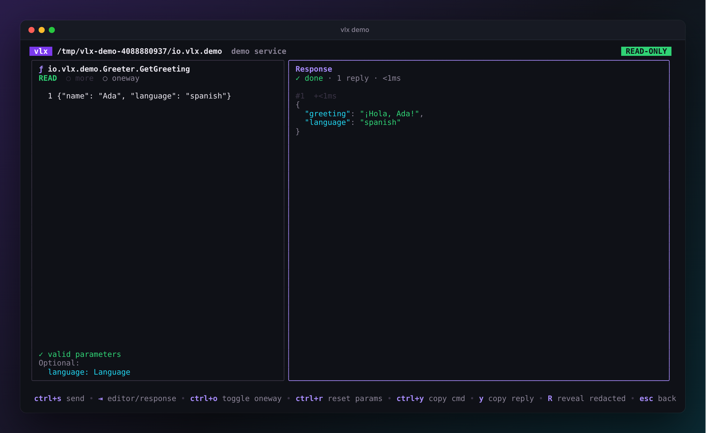

# QuickStart

{ .vlx-diagram }

## <span class="vlx-step">1</span> Install

=== "Go"

    ```sh
    go install github.com/rossedman/vlx/cmd/vlx@latest
    ```

=== "Download"

    Grab the archive for your platform from the
    [latest release](https://github.com/rossedman/vlx/releases/latest), then:

    ```sh
    tar -xzf vlx_*_linux_amd64.tar.gz vlx
    sudo install vlx /usr/local/bin/
    ```

=== "Debian / Ubuntu"

    ```sh
    sudo apt install ./vlx_*_linux_amd64.deb
    ```

=== "Fedora / RHEL"

    ```sh
    sudo dnf install ./vlx_*_linux_amd64.rpm
    ```

Check it works:

```sh
vlx version
```

More options, including shell completion, are on the
[Installation](installation.md) page.

## <span class="vlx-step">2</span> Open the demo

The demo service runs anywhere, so start there:

```sh
vlx demo
```

vlx starts a small sample service and opens the explorer on it. You will see
three panes: **Services**, **Interfaces** and **Detail**.

{ .vlx-shot }

Move with ++up++ / ++down++ (or ++j++ / ++k++), and switch panes with
++tab++. The Detail pane always describes what is selected: the method's
documentation, its parameters and return values, the types it uses and its
safety class.

!!! tip "Lost? Press ++"?"++"
    The bottom line always shows the keys that work right now, and ++"?"++
    shows them all.

## <span class="vlx-step">3</span> Call a method

1. Select **GetGreeting** under `io.vlx.demo.Greeter` and press ++enter++.
2. The editor opens with the parameters already filled in from the schema:
   `{"name": ""}`. Type a name between the quotes.
3. Press ++ctrl+s++ to send.

{ .vlx-shot }

The reply appears on the right. Try a few more:

| Method | What it shows |
| --- | --- |
| `WatchCountdown` | a **stream**: one reply per tick, live. ++esc++ stops it. |
| `GetItem` with `{"id": 42}` | a **typed error**, with its documentation from the IDL |
| `GetSupplier` | a secret field shown as `«redacted»` (++shift+r++ reveals it) |
| `SetDefaultLanguage` | a **WRITE** method, which vlx refuses to send in read-only mode |

Press ++esc++ to go back to the tree, and ++q++ to quit.

## <span class="vlx-step">4</span> Explore your system

On a Linux machine with systemd v257 or newer, just run:

```sh
vlx
```

Pick a service, press ++enter++ to connect, and browse. Many system services
only talk to root, so if a service shows `⊘` or *permission denied*:

```sh
sudo vlx
```

vlx stays **read-only** even as root. See [Safety](../guides/safety.md) for
how to enable writes when you mean to.

## <span class="vlx-step">5</span> Script it

Everything you did in the TUI has a command. Press ++ctrl+y++ on the call
screen to copy it, or write it yourself:

```sh
vlx list                                        # what is there?
vlx describe hostname                           # print the IDL
vlx call hostname io.systemd.Hostname.Describe  # call a method
vlx call resolve ResolveHostname '{"name":"example.com"}' -o json | jq .
```

## Next steps

- [The explorer](../guides/explorer.md) — every pane and key.
- [Calling methods](../guides/calling.md) — parameters, streams and errors.
- [Safety](../guides/safety.md) — what vlx will and will not send.
- [systemd recipes](../guides/systemd.md) — useful calls for real services.
