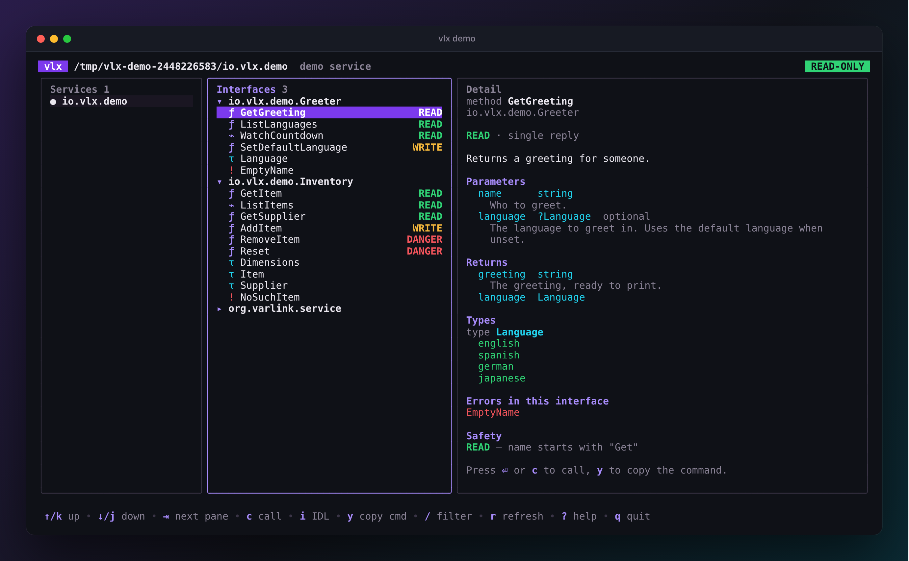
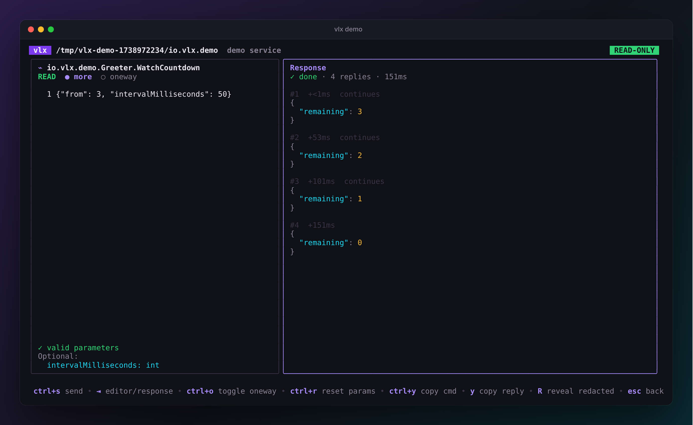

# The explorer

Run `vlx` (or `vlx explore`) to open the explorer. Give it a service to jump
straight in:

```sh
vlx                                       # pick from discovered sockets
vlx hostname                              # a unique part of a socket name
vlx /run/systemd/io.systemd.Hostname      # a path
vlx unix:/run/systemd/io.systemd.Manager  # varlinkctl's address form
```

{ .vlx-shot }

## The header

The header shows the socket you are connected to and two badges:

- **`READ-ONLY`** (green) or **`WRITES ENABLED`** (amber) — the
  [safety mode](safety.md).
- **`ROOT`** (red) when vlx runs as root, as a reminder that calls run with
  full privileges.

## The panes

| Pane | What it shows |
| --- | --- |
| **Services** | Every socket vlx found. Nothing is sent to a service until you press ++enter++ on it. |
| **Interfaces** | A tree of the interfaces the open service implements, with their methods, types and errors. |
| **Detail** | Everything about the selection: docs, parameters, return values, the types used, errors, and the safety class with its reason. |

Narrow terminals (under 100 columns) show two panes at a time; the focused
one decides which.

### Symbols

vlx never relies on colour alone: every state also has a glyph or a word.

| Symbol | Meaning |
| --- | --- |
| `ƒ` | method with a single reply |
| `⌁` | method that streams (supports or requires `more`) |
| `τ` | type |
| `!` | error |
| `●` / `○` / `✗` | service connected / not opened yet / failed |
| `⊘` | you lack permission to connect to this socket |
| <span class="vlx-read">READ</span> <span class="vlx-write">WRITE</span> <span class="vlx-danger">DANGER</span> | the method's [safety class](safety.md) |

## Moving around

| Key | Action |
| --- | --- |
| ++up++ ++down++ / ++k++ ++j++ | move |
| ++tab++ ++shift+tab++ / ++left++ ++right++ / ++h++ ++l++ | change pane |
| ++enter++ | open a service, expand an interface, or call a method |
| ++space++ | expand or collapse an interface |
| ++"/"++ | filter the focused list; ++enter++ keeps the filter, ++esc++ clears it |
| ++i++ | show the raw IDL of the selected interface |
| ++y++ | copy the `vlx call` command for the selected method |
| ++r++ | re-discover sockets and re-introspect the service |
| ++esc++ | go back one step |
| ++"?"++ | help |
| ++q++ | quit |

Filtering the interfaces tree searches across every interface at once:
++"/"++ then `user` shows every method, type and error with *user* in its
name.

## The call screen

Press ++enter++ or ++c++ on a method.

{ .vlx-shot }

On the left is the **parameter editor**, pre-filled with a skeleton built
from the method's input type: every required field has a typed placeholder,
and optional fields are listed underneath. vlx validates what you type
against the IDL on every keystroke, and will not send invalid parameters.

Above the editor are the method's safety class and two toggles:

- **more** — ask for a stream of replies. On for methods that stream, forced
  on for methods that require it, unavailable for methods that cannot.
- **oneway** — send without waiting for a reply. A oneway call is always
  treated as at least a <span class="vlx-write">WRITE</span>.

On the right is the **response**: every reply as colourised JSON with its
number and arrival time, the error (with its IDL documentation) if the call
failed, and a hint when vlx knows what to do about it.

| Key | Action |
| --- | --- |
| ++ctrl+s++ | send |
| ++tab++ | switch between editor and response |
| ++ctrl+t++ / ++ctrl+o++ | toggle more / oneway |
| ++ctrl+r++ | reset the parameters to the skeleton |
| ++ctrl+y++ | copy the equivalent `vlx call` and `varlinkctl call` commands |
| ++y++ | (response) copy the replies as JSON |
| ++shift+r++ | (response) reveal redacted values |
| ++esc++ | stop a running stream, or go back to the tree |

Your edits are kept per method until you quit, so you can go back and forth.

!!! info "Clipboard"
    vlx copies with the OSC 52 escape sequence, which most modern terminals
    (and tmux with `set -g set-clipboard on`) support, including over SSH.

## Redaction

Values under keys that look secret — `password`, `hashedPassword`,
`privileged`, anything with `token`, `secret` or `privateKey` — are shown as
`«redacted»` so they do not end up in screenshots or screen shares. Press
++shift+r++ on the response to reveal them; configure the patterns with
[`redact`](configuration.md).
