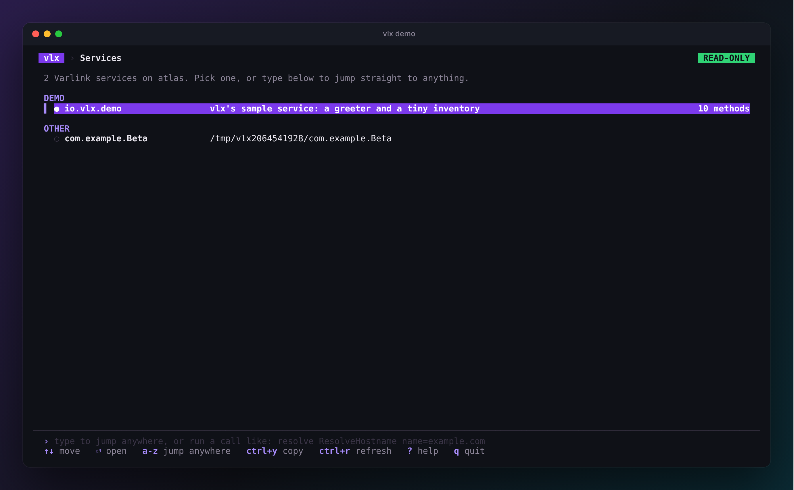
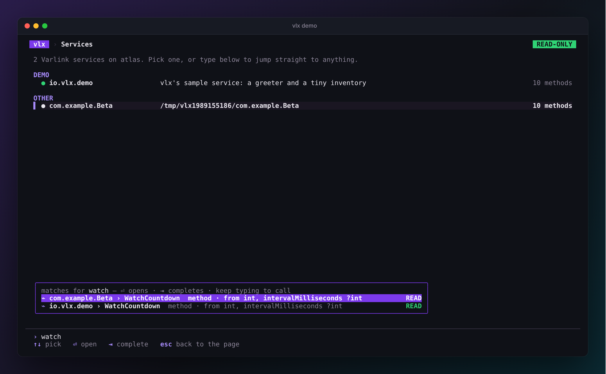
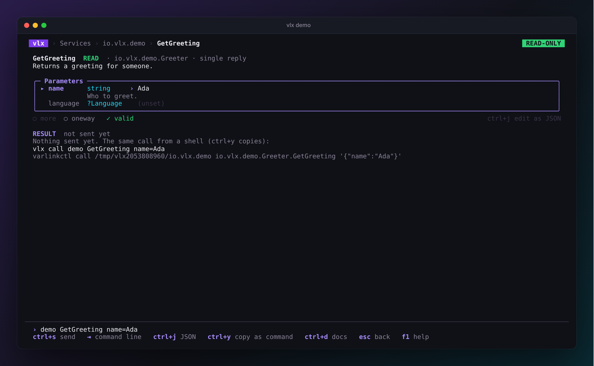

# The explorer

Run `vlx` (or `vlx explore`) to open the explorer. Give it a service to jump
straight in:

```sh
vlx                                       # start from the list of services
vlx hostname                              # a unique part of a socket name
vlx /run/systemd/io.systemd.Hostname      # a path
vlx unix:/run/systemd/io.systemd.Manager  # varlinkctl's address form
```

{ .vlx-shot }

The explorer shows **one page at a time** — all services, one service, one
method — and a **command line** along the bottom that is always there. Use
the arrow keys and ++enter++ to drill down, or just start typing to jump
anywhere.

## The header

The top line is a breadcrumb — `vlx › Services › Resolve › ResolveHostname`
— and two badges:

- **`READ-ONLY`** (green) or **`WRITES ENABLED`** (amber) — the
  [safety mode](safety.md).
- **`ROOT`** (red) when vlx runs as root, as a reminder that calls run with
  full privileges.

++esc++ (or ++left++) always goes up one level.

## Services

The home page lists every socket vlx found, grouped — System, Network,
Users & login, Machines & images, Storage, Security, Devices, Your session —
with a plain-language description of what each one is for. Your most recent
calls sit at the top; ++enter++ on one brings it back with the same
parameters.

### Preview

As the cursor rests on a service, vlx reads its description in the
background and shows how many methods it has. This uses only the read-only
introspection methods every Varlink service implements, and results are
cached. Prefer to connect only when you ask? Set `preview: false` in the
[config](configuration.md) or run `vlx --no-preview`.

## A service

{ .vlx-shot }

A service page lists its interfaces with their methods, types and errors,
each with the first line of its documentation and, for methods, its
[safety class](safety.md). The `org.varlink.service` and
`io.systemd.service` interfaces, which every service carries, start
collapsed.

++enter++ opens a method, type or error; ++space++ expands or collapses an
interface; ++ctrl+d++ shows documentation and the raw IDL.

## The command line

Start typing on any list page — or press ++"/"++, ++":"++ or ++ctrl+k++ —
and the command line shows what matches across every service, interface,
method, type and error:

{ .vlx-shot }

Type a few words in any order (`resolve host`, `user record`, `unit list`),
pick with ++up++ / ++down++, and press ++enter++ to go there, or ++tab++ to
complete the line.

Keep typing and the line becomes a call:

```text
SERVICE [METHOD] [NAME=VALUE ...]
```

```text
demo GetGreeting name=Ada language=german
resolve ResolveHostname name=example.com
hostname Describe
```

- **SERVICE** is anything `vlx call` accepts: a unique part of a socket
  name, a socket name or a path. An interface's name works too — `unit List`
  finds `io.systemd.Unit` on the service manager — and so does a method name
  on its own when only one service has it.
- **NAME=VALUE** sets a parameter. Quote values with spaces like a shell:
  `name='Ada Lovelace'`. Strings and enum values are taken as typed;
  numbers, booleans, arrays and structs are JSON.

As soon as the line names a method, the popup lists its parameters. ++enter++
opens the method page and, if you gave parameters (or the method needs
none), sends the call. ++up++ and ++down++ on an empty match list bring back
earlier calls, like a shell's history.

## A method

{ .vlx-shot }

A method page has the method's documentation, a **parameter form**, and the
**result** of the last call, followed by earlier calls of the same method.

**The form and the command line are the same call.** Edit a field and the
command line updates; press ++tab++ to move to the command line, edit it,
and the form follows. ++enter++ there sends; ++ctrl+s++ sends from anywhere
on the page.

{ .vlx-shot }

| Type | How you edit it |
| --- | --- |
| `string` | type text |
| `int`, `float` | type a number |
| `bool`, enums | ++left++ / ++right++ or ++space++ to choose, or type the first letters |
| structs, arrays, maps | a JSON value, pre-filled with a skeleton |

Move between fields with ++up++ / ++down++. The current field shows its
documentation. **Optional** parameters (`?T`) are left out until you give
them a value. vlx checks every value against the IDL as you type and will
not send invalid parameters. Prefer JSON? ++ctrl+j++ edits all the
parameters as one JSON object, and back.

Under the form are two toggles and whether the parameters are valid:

- **more** — ask for a stream of replies. On for methods that stream, forced
  on for methods that require it, unavailable for methods that cannot.
- **oneway** — send without waiting for a reply. A oneway call is always
  treated as at least a <span class="vlx-write">WRITE</span>.

The **result** shows every reply as colourised JSON with its number and
arrival time, the error (with its IDL documentation) if the call failed, and
a hint when vlx knows what to do about it. Streams arrive live; ++esc++
stops them.

{ .vlx-shot }

++tab++ cycles the form → the command line → the result. With the result
focused, ++up++ / ++down++ scroll, ++y++ copies the replies as JSON and
++shift+r++ reveals redacted values. ++ctrl+y++ copies the call as `vlx call`
and `varlinkctl call` commands.

Each method keeps its parameters and last result until you quit, so you can
wander off and come back.

!!! info "Clipboard"
    vlx copies with the OSC 52 escape sequence, which most modern terminals
    (and tmux with `set -g set-clipboard on`) support, including over SSH.

## Symbols

vlx never relies on colour alone: every state also has a glyph or a word.

| Symbol | Meaning |
| --- | --- |
| `ƒ` | method with a single reply |
| `⌁` | method that streams (supports or requires `more`) |
| `τ` | type |
| `!` | error |
| `●` / `○` / `✗` | service read / not read yet / failed |
| `⊘` | you lack permission to connect to this socket |
| <span class="vlx-read">READ</span> <span class="vlx-write">WRITE</span> <span class="vlx-danger">DANGER</span> | the method's [safety class](safety.md) |

## Redaction

Values under keys that look secret — `password`, `hashedPassword`,
`privileged`, anything with `token`, `secret` or `privateKey` — are shown as
`«redacted»` so they do not end up in screenshots or screen shares. Press
++shift+r++ on the result to reveal them; configure the patterns with
[`redact`](configuration.md).

All the keys are listed on the [Keys](../reference/keys.md) page.
