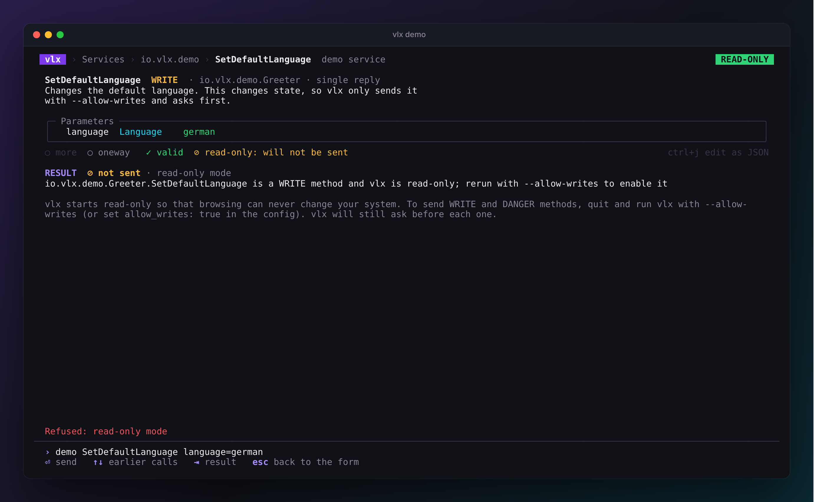
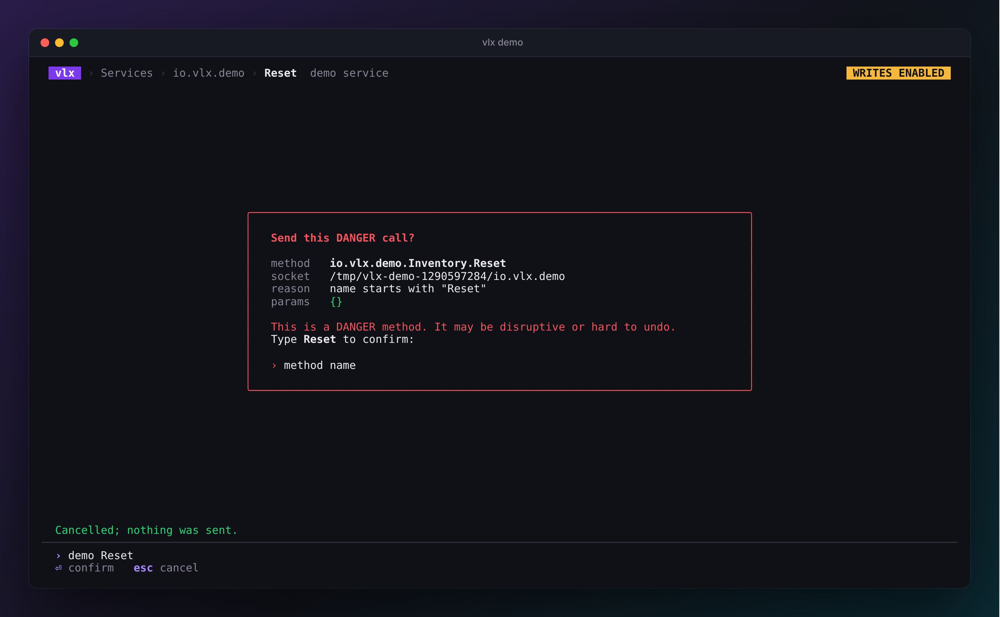

# Safety

vlx talks directly to privileged system services, often as root. Browsing
must never change anything, and a slip of a key must never reboot a machine,
wipe a disk or extend a TPM PCR. This page explains how vlx makes sure of
that.

{ .vlx-diagram }

## Classes

Every method has one of three classes, shown next to it everywhere:

| Class | Meaning | Examples |
| --- | --- | --- |
| READ | No side effects. | `Hostname.Describe`, `Resolve.ResolveHostname`, `Unit.List`, `UserDatabase.GetUserRecord` |
| WRITE | Changes state, or reveals secrets. **The default for anything unknown.** | `service.SetLogLevel`, `Unit.SetProperties`, `Credentials.Decrypt`, `Journal.Rotate` |
| DANGER | Disruptive, hard to undo or security-sensitive. | `Manager.Reexecute`, `Machine.Kill`, `PCRExtend.Extend`, `Repart.Run`, `Network.Link.Down` |

vlx decides the class in this order, and the first rule that matches wins:

1. **Your overrides** in the [config file](configuration.md#safety-overrides).
2. **A built-in table** that covers every `io.systemd.*` method in systemd
   v257, v258 and v260. A test fails if a new systemd release adds a method
   without a rule, so systemd methods never depend on guesswork.
3. **The method's verb.** `Get…`, `List…`, `Describe…`, `Resolve…`,
   `Subscribe…`, `Dump…`, `Can…` and similar are READ; `Kill…`, `Remove…`,
   `Delete…`, `Reset…`, `Reboot…`, `PowerOff…` and similar are DANGER.
   Verbs match whole words, so `IsReady` is READ but `Issue` is not.
4. **Otherwise WRITE.** Unknown is never assumed safe.

A **oneway** call is always at least WRITE, since its effect cannot be seen.
A method's documentation page (++ctrl+d++) shows the class and the rule that produced it.

## The policy

=== "Read-only (default)"

    READ methods are sent. WRITE and DANGER methods can be browsed, and their
    parameters prepared and validated, but vlx refuses to send them and tells
    you how to change that.

    { .vlx-shot }

=== "With --allow-writes"

    The header badge turns amber. READ methods are sent as before.

    - **WRITE** methods show a confirmation with the method, socket,
      parameters and reason: press ++y++ to send, anything else cancels.
    - **DANGER** methods additionally require you to type the method's name.

    { .vlx-shot }

Turn writes on for one session with `--allow-writes`, in the environment
with `VLX_ALLOW_WRITES=1`, or permanently with `allow_writes: true` in the
config. On the command line, `vlx call` prompts on a terminal; in scripts
`--yes` confirms instead, and without it vlx refuses with exit code `4`.

## Limits

| Limit | Default | Why |
| --- | --- | --- |
| Timeout | 10 s | A stuck service cannot hang vlx. Streams are exempt but stop on ++esc++ / ++ctrl+c++. |
| Max frame size | 16 MiB | Bounds memory per message. |
| Max kept replies | 1000 | Long streams keep the newest replies in the TUI and say how many were dropped. |
| File descriptors | closed on arrival | Received descriptors never leak; vlx never sends any. |

## Terminal hygiene

Everything a service sends — interface names, doc comments, error names,
values — is controlled by that service. vlx strips control characters,
escape sequences and bidirectional overrides from all of it before drawing,
so a malicious or buggy service cannot move the cursor, rewrite the screen,
set your window title or write to your clipboard.

Secret-looking fields are [redacted](explorer.md#redaction) on screen.
vlx keeps no history and writes no files except `vlx config init`.

## Attack surface

- **Unix sockets only.** No `ssh:` or `exec:` transports, no shelling out,
  no plugins.
- **Discovery is passive.** Listing reads a fixed set of directories one
  level deep and never connects; `vlx list --probe` only sends `GetInfo`.
  In the explorer, preview and search read services with the read-only
  introspection methods only — turn that off with `preview: false` or
  `--no-preview`.
- **The config file is checked.** It can enable writes, so vlx refuses a
  config file that is writable by group or others, or owned by anyone other
  than you or root.
- **No privilege escalation.** vlx never asks for more privileges. When you
  run it as root it says so, in red, on every screen.

See the [specification](../project/spec.md#6-safety-model) for the full
design and [Security](../project/security.md) to report a problem.
