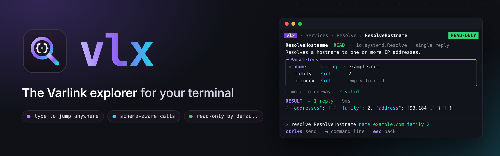

# vlx { .vlx-hidden }

<strong>vlx</strong> finds every Varlink socket on your machine and lets you
browse its interfaces, read the documentation that ships with them, and call
methods with an editor that already knows the schema — <strong>without ever
changing your system unless you ask it to.</strong>

<a class="md-button md-button--primary" href="getting-started/quickstart/">QuickStart</a>
<a class="md-button" href="https://github.com/rossedman/vlx">GitHub</a>

go install github.com/rossedman/vlx/cmd/vlx@latest && vlx demo

:material-magnify-scan:
### Discover
Run `vlx`. It lists the Varlink sockets under `/run/systemd`, `/run/varlink/registry` and friends — no flags, no config.

:material-file-tree:
### Browse
Interfaces appear as you move. ++ctrl+k++ searches every method, type and error on the machine at once.

:material-code-json:
### Call
A form built from the schema — pickers for enums, inline docs, checks as you type. Replies stream in live.

:material-shield-check:
### Stay safe
Read-only by default. Writes need `--allow-writes` *and* a confirmation; dangerous methods need their name typed back.

:material-console:
### Script it
Everything the TUI does has a command: `vlx call … -o json`, stable exit codes, NDJSON streams.

:material-school:
### Learn
`vlx demo` serves a sample service anywhere — macOS included — and every screen shows the equivalent `varlinkctl` command.

{ .vlx-shot }

## How it works

{ .vlx-diagram }

vlx is built on [sdvarlink](https://github.com/rossedman/sdvarlink), a pure-Go
Varlink library with an IDL parser, and on Charm's
[Bubble Tea](https://github.com/charmbracelet/bubbletea),
[Bubbles](https://github.com/charmbracelet/bubbles) and
[Lip Gloss](https://github.com/charmbracelet/lipgloss), with
[Cobra](https://github.com/spf13/cobra) and
[Viper](https://github.com/spf13/viper) for the command line.

[Get started in two minutes :material-arrow-right:](getting-started/quickstart.md){ .md-button .md-button--primary }
