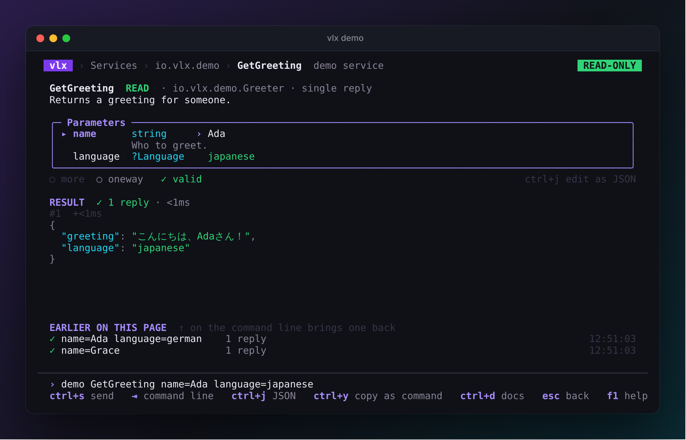
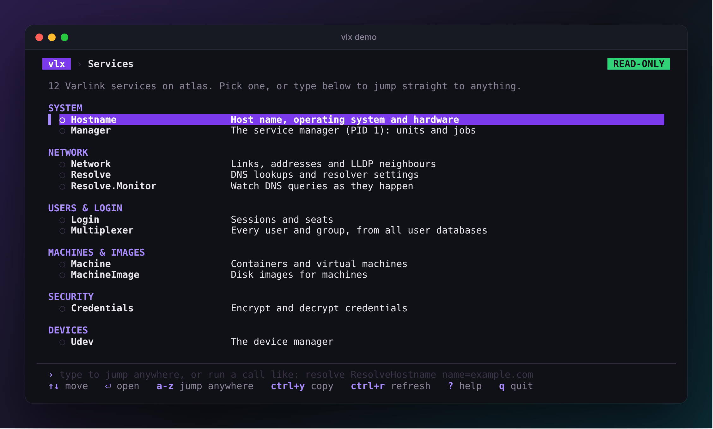
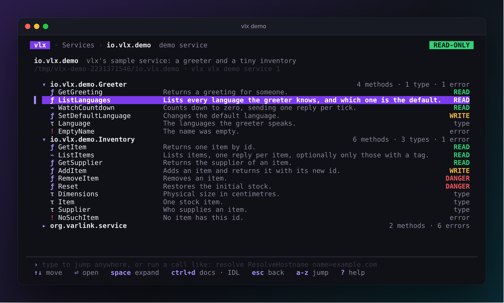
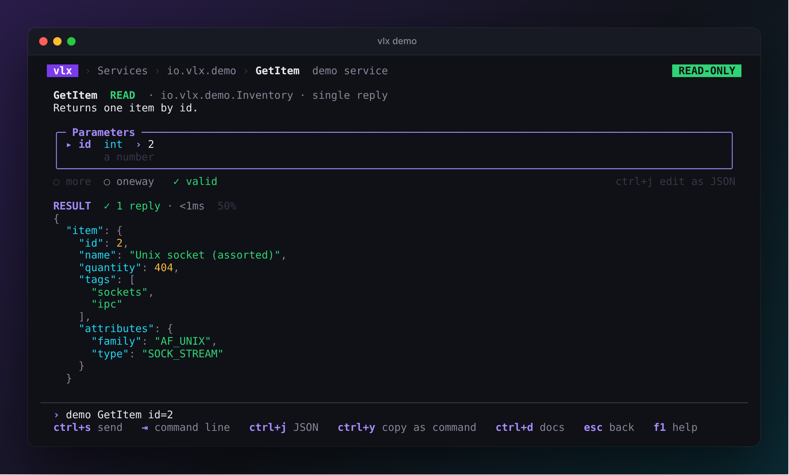
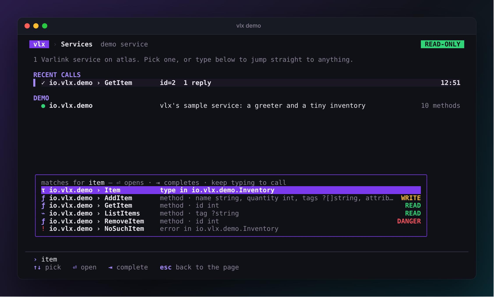
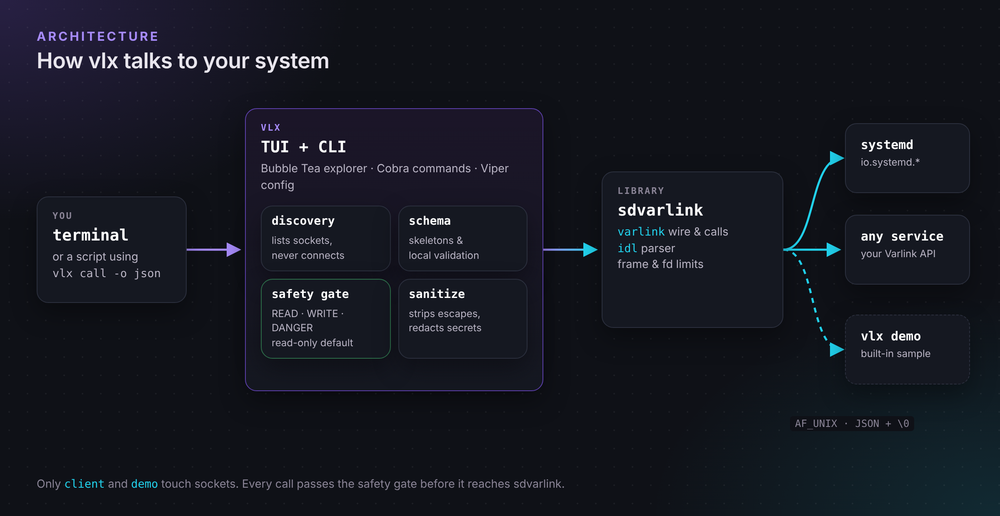

# vlx { .vlx-hidden }

<div class="vlx-home" markdown>

<section class="vlx-hero" markdown>
<div class="vlx-hero__text" markdown>
<p class="vlx-eyebrow">The Varlink explorer for your terminal</p>
<p class="vlx-hero__title">Every Varlink API on your machine, <span>one keystroke away.</span></p>
<p class="vlx-hero__lead">
vlx finds the Varlink sockets systemd and friends serve, shows what each one
does in plain language, and calls any method with a form that already knows
its schema. It is <strong>read-only until you say otherwise</strong>.
</p>
<p class="vlx-hero__actions">
<a class="md-button md-button--primary" href="getting-started/quickstart/">Get started</a>
<a class="md-button" href="guides/explorer/">Tour the explorer</a>
</p>
<div class="vlx-install">
<span class="vlx-install__prompt">$</span><code>go install github.com/rossedman/vlx/cmd/vlx@latest</code>
<span class="vlx-install__prompt">$</span><code>vlx demo</code>
</div>
<p class="vlx-hero__note">Linux, macOS · amd64, arm64 · <code>vlx demo</code> runs anywhere, no systemd needed.</p>
</div>
<div class="vlx-hero__shot">

</div>
</section>

<section class="vlx-line" markdown>
<p class="vlx-section__eyebrow">Type it, or click through it</p>
<p class="vlx-section__title">One line names any call</p>
<p class="vlx-section__lead">Arrow through the pages, or type on the command line that sits under every page. The form and the line stay in sync, and the same line works after <code>vlx call</code> in a script.</p>

<div class="vlx-grammar" role="img" aria-label="resolve is the service, ResolveHostname is the method, name=example.com and family=2 are parameters">
<span class="vlx-grammar__prompt">›</span>
<span class="vlx-grammar__part vlx-grammar__part--svc"><code>resolve</code><small>service</small></span>
<span class="vlx-grammar__part vlx-grammar__part--method"><code>ResolveHostname</code><small>method</small></span>
<span class="vlx-grammar__part vlx-grammar__part--arg"><code>name=example.com</code><small>parameter</small></span>
<span class="vlx-grammar__part vlx-grammar__part--arg"><code>family=2</code><small>parameter</small></span>
<span class="vlx-grammar__enter">⏎</span>
</div>

<ul class="vlx-line__notes">
<li><strong>A few letters</strong> jump to any service, method, type or error.</li>
<li><strong><kbd>⇥</kbd></strong> completes. Once a method is named, its parameters are listed as you type.</li>
<li><strong><kbd>⏎</kbd></strong> opens the page, or sends the call if you gave parameters.</li>
</ul>
</section>

<section class="vlx-tour" markdown>

=== "Services"

    { .vlx-shot loading=lazy }

    Every socket vlx finds, grouped by what it is for — System, Network,
    Users & login, Machines, Storage — with a sentence on what each does.
    Your recent calls are listed first.

=== "A service"

    { .vlx-shot loading=lazy }

    Interfaces, methods, types and errors, each with the first line of its
    documentation and, for methods, whether it is safe to call.

=== "A method"

    { .vlx-shot loading=lazy }

    A form built from the IDL — pickers for enums, inline docs, checks as you
    type — and the result underneath. Streams arrive live; <kbd>esc</kbd>
    stops them.

=== "Search"

    { .vlx-shot loading=lazy }

    Start typing anywhere. Matches come from every service on the machine,
    read in the background with read-only introspection.

</section>

<section class="vlx-features" markdown>
<div class="vlx-feature" markdown>
:material-radar:{ .vlx-feature__icon }
<h3>Finds everything</h3>
Sockets under <code>/run/systemd</code>, <code>/run/varlink/registry</code>, <code>/run/udev</code> and your session. No flags, no config.
</div>
<div class="vlx-feature" markdown>
:material-book-open-variant:{ .vlx-feature__icon }
<h3>Reads the docs to you</h3>
Doc comments from the IDL next to every method, parameter, type and error. Raw IDL is a keystroke away.
</div>
<div class="vlx-feature" markdown>
:material-form-textbox:{ .vlx-feature__icon }
<h3>Knows the schema</h3>
Parameters are checked against the IDL as you type. vlx will not send a call the service would reject.
</div>
<div class="vlx-feature" markdown>
:material-waves:{ .vlx-feature__icon }
<h3>Streams live</h3>
Methods that stream show each reply as it arrives, with typed errors and their documentation when things fail.
</div>
<div class="vlx-feature" markdown>
:material-console-line:{ .vlx-feature__icon }
<h3>Scripts cleanly</h3>
<code>vlx call … -o json</code>, NDJSON streams and stable exit codes. Every screen can copy its call as a command.
</div>
<div class="vlx-feature" markdown>
:material-school-outline:{ .vlx-feature__icon }
<h3>Teaches varlinkctl</h3>
Every call shows the equivalent <code>varlinkctl</code> command, so what you learn in vlx carries over.
</div>
</section>

<section class="vlx-safety" markdown>
<div class="vlx-safety__intro" markdown>
<p class="vlx-section__eyebrow">Safe by default</p>
<p class="vlx-section__title">Browse as root without breaking anything</p>
<p class="vlx-section__lead">Every method is classified before it is sent. vlx starts read-only, so you can open any service and prepare any call while only reads go out.</p>
[How the safety model works :material-arrow-right:](guides/safety.md)
</div>
<div class="vlx-safety__classes">
<div class="vlx-class vlx-class--read"><span class="vlx-class__tag">READ</span><p><strong>Always allowed.</strong> No side effects: <code>Describe</code>, <code>List…</code>, <code>Resolve…</code>.</p></div>
<div class="vlx-class vlx-class--write"><span class="vlx-class__tag">WRITE</span><p><strong>Needs <code>--allow-writes</code></strong> and a <kbd>y</kbd> for each call. Unknown methods land here.</p></div>
<div class="vlx-class vlx-class--danger"><span class="vlx-class__tag">DANGER</span><p><strong>Needs <code>--allow-writes</code></strong> and the method's name typed back: <code>Reboot</code>, <code>Remove…</code>.</p></div>
</div>
</section>

<section class="vlx-script" markdown>
<div class="vlx-script__text" markdown>
<p class="vlx-section__eyebrow">Script it</p>
<p class="vlx-section__title">The line you type is the command you run</p>
<p class="vlx-section__lead">Whatever you call in the explorer, <kbd>ctrl+y</kbd> copies as a command. Pipe the JSON into <code>jq</code>, or let the exit code drive your script.</p>
[Scripting with vlx :material-arrow-right:](guides/scripting.md)
</div>
<div class="vlx-script__code" markdown>
```console
$ vlx call demo GetGreeting name=Ada language=german -o json \
    | jq -r .greeting
Hallo, Ada!

$ vlx call demo SetDefaultLanguage language=german
vlx: io.vlx.demo.Greeter.SetDefaultLanguage is a WRITE method and vlx is
read-only; rerun with --allow-writes to enable it
$ echo $?
4
```
</div>
</section>

<section class="vlx-how" markdown>
<p class="vlx-section__eyebrow">How it works</p>
<p class="vlx-section__title">A safety gate in front of a pure-Go Varlink client</p>

{ .vlx-diagram loading=lazy }

vlx is built on [sdvarlink](https://github.com/rossedman/sdvarlink), a pure-Go
Varlink library with an IDL parser, and on Charm's
[Bubble Tea](https://github.com/charmbracelet/bubbletea),
[Bubbles](https://github.com/charmbracelet/bubbles) and
[Lip Gloss](https://github.com/charmbracelet/lipgloss), with
[Cobra](https://github.com/spf13/cobra) and
[Viper](https://github.com/spf13/viper) for the command line.
</section>

<section class="vlx-cta" markdown>
<p class="vlx-cta__title">Two minutes to your first call</p>
<p class="vlx-cta__lead">The QuickStart runs against the built-in demo service, so it works on any machine.</p>
<p class="vlx-hero__actions">
<a class="md-button md-button--primary" href="getting-started/quickstart/">Open the QuickStart</a>
<a class="md-button" href="https://github.com/rossedman/vlx">View on GitHub</a>
</p>
</section>

</div>
